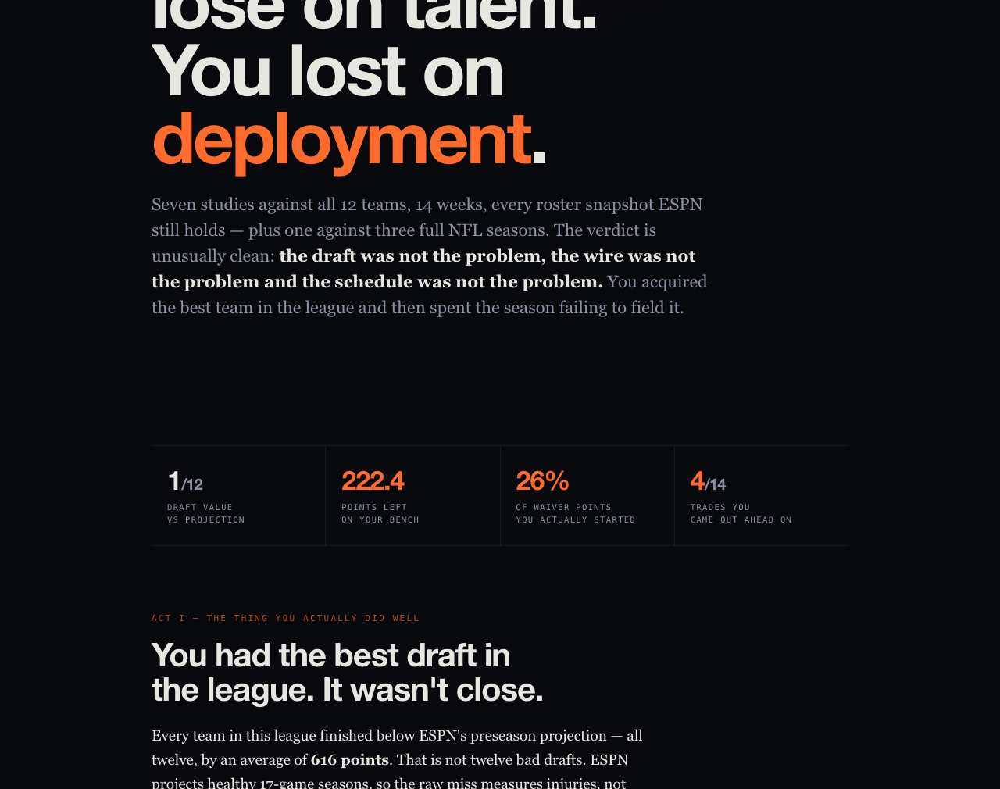

# Fantasy Edge

**A data tool I built for my ESPN fantasy football league. It blends ESPN, market and analyst rankings into one draft board, runs 20,000 simulated seasons for playoff odds, and pings me on Telegram only when something actually changes.**


A decision-support suite for a private ESPN league (PPR scoring). It turns raw league,
market, and play-by-play data into ranked, explainable recommendations: draft board,
start/sit, waiver pickups, trade targets.


The live site is deployed but locked behind a secret link, since it reads a private league's rosters through
personal ESPN cookies. The screenshot above is the real app against the real league.
Other managers' team names are replaced with "Team 4" etc. in this repo.

## What the data told me about my own season

After the 2025 season I turned the tool on myself: seven studies across all 12 teams and
14 weeks, plus one across three NFL seasons. The result is a one-page postmortem,
[`site/2025-postmortem.html`](site/2025-postmortem.html):



- **My draft found the most value in the league:** my team beat its preseason projection by 558 points more than the league average did.
- **I lost on lineups.** I left 222 points on my bench, and only 26% of the points my waiver pickups scored came while they were in my lineup.
- **I traded too much.** I came out ahead on 4 of 14 trades.
- **Handcuffs beat sleepers.** Across three NFL seasons, a backup running back who inherits the job
  became startable 63% of the time, and the rate barely moved year to year. Speculative late-round
  running backs in my 2025 draft hit 19%. The two numbers measure different groups, so this is a
  strong hint, not proof.

Each finding turned into a rule for 2026 and a feature in the app (for example, a daily
handcuff watch that alerts me when a starter goes down).

## What it does

| Tool | What it answers |
|---|---|
| **Draft board** | Who is the best pick right now, and by how much? Value-based drafting (VBD: how many more points a player scores than a replacement-level player at his position) with computed tiers and cliff detection. |
| **Start / Sit** | Which lineup maximizes projected points this week? |
| **Waiver finder** | Who should I bid on, and how much of my FAAB budget (the free-agent bidding money each team gets per season)? |
| **Trade finder** | Which two rosters have a mutually profitable swap? |
| **Seed simulator** | Monte Carlo over the remaining schedule — what are my playoff odds? |
| **Live draft sync** | A bookmarklet scrapes an in-progress ESPN draft and crosses picks off the board in real time. |

## The interesting part: consensus, not one source

An early version just ranked players by ESPN's projections. That is one opinion.

The board now blends, per position: ESPN's projection rank, market ADP, and every
analyst board dropped into the repo as a JSON file. The blended rank maps back onto a
points curve, then VBD and tiers run on top of that.

Three rules keep it honest:

- **A source that omits a player casts no vote.** An analyst whose board stops at 150
  does not silently rank everyone else last.
- **One analyst, one ranked file.** Ingesting the same analyst's board from four videos
  would let him vote four times.
- **Opinion never touches value math.** In-season video takes are shown as context next
  to a recommendation; they never move VBD, tiers, or projections.

Adding an analyst is a file drop, not a code change.

## Data sources — all free, no paid APIs

- **ESPN Fantasy API** — league state, rosters, projections, FAAB budgets
- **Sleeper** — trending adds, depth charts, injury status
- **nflverse** — play-by-play derived stats: target share, air-yards share, WOPR, EPA,
  CPOE, snap share, yards before/after contact
- **ESPN public site API** — injuries and news, tagged to players
- **Analyst boards** — transcribed from public videos and published PDFs
- **Social sentiment** — Reddit / YouTube / TikTok, for a narrow shortlist of players
  where the crowd knows something the box score does not

## Stack

Plain HTML + JS single page, no framework. Node server, deployed as a Vercel function.
Seven GitHub Actions workflows (six on a schedule) run the jobs. State persists through the
Actions cache. Alerts are change-driven: Claude is only called when the underlying data actually moved.
Hosting is free; the AI calls run on my existing Claude subscription.

## Engineering notes

A few problems that were more interesting than they looked:

- **Tiers are computed, not declared.** Splitting a position wherever the VBD gap is
  "big" produces 127 tiers, because a position-wide median gap is dragged to zero by the
  flat tail. The gap has to be measured against a *local* rolling median.
- **Seeding is record-first.** The league setting is literally named
  `playoffSeedingRule: TOTAL_POINTS_SCORED`, which reads like a points-only league. It
  is the tiebreaker. Reading it the other way inverts every conclusion the playoff
  simulator draws — verified against the league's actual final standings, where the
  second-highest scoring team missed the cut.
- **Silent API failures.** ESPN accepts `?view=a,b` with a 200 and quietly omits half
  the response; it needs repeated `&view=` params. A search tool silently capped a query
  at two sources and dropped the third with no error. Both were found by checking output
  against a known-good baseline rather than trusting the status code.
- **Absence is not a zero.** Whether it is an analyst who skipped a player or a rookie
  with no prior-season snaps, a missing input must not be scored as a bad one.

## Running it

```bash
node server.js   # http://localhost:4650
```

Needs a `.env` with `LEAGUE_ID`, `ESPN_S2`, `SWID`. No secrets are committed —
production values live in Vercel and GitHub Actions secrets.

## How I built it

I designed every model and rule here, chose what to measure, and checked the answers
against what really happened in my league. I wrote the code with
[Claude Code](https://claude.com/claude-code) as my pair programmer. The part I'm proudest
of is the habit the engineering notes above show: never trust a number until it matches
a known-good baseline.

---

Built by **Ethan Yap** · UC Davis · [LinkedIn](https://www.linkedin.com/in/ethan-yap-827a45346/)
